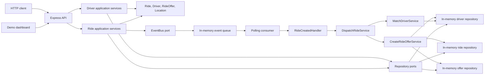

# Architecture

The demo is a modular monolith. HTTP routes translate requests and responses;
application services coordinate use cases; domain entities enforce state and
coordinate invariants; repository and event-bus ports isolate infrastructure.
In-memory adapters make the complete workflow runnable without a database or
external message broker.

Ride creation persists the new ride and queues `RideCreated`. The independent
consumer later invokes the handler and dispatch coordinator. Matching selects
a candidate; atomic driver claiming and offer/lifecycle changes are delegated
to the relevant services/repository. Rejections and expirations can return a
ride to matching and initiate another dispatch attempt.

The in-memory adapters and single Node.js process are deliberate limits of the
demo, not production scaling or durability guarantees.
