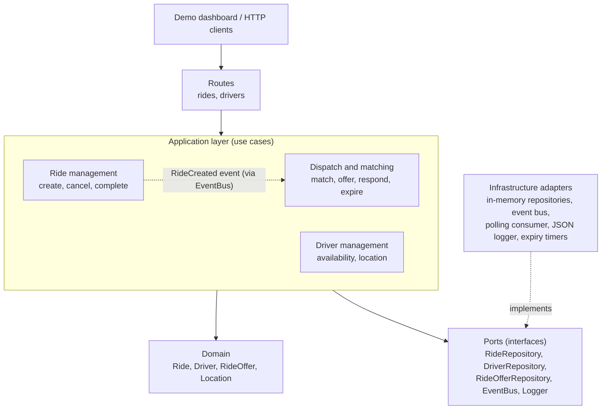
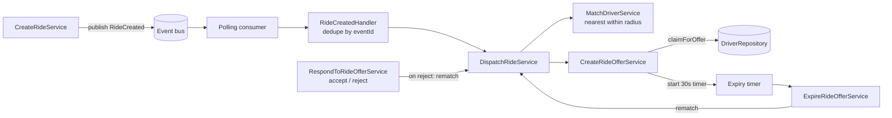

# Architecture

## 1. Overview

The system is a **modular monolith** written in TypeScript and Express. It
accepts ride requests, finds the nearest available driver, offers the ride,
and handles accept, reject, timeout, cancel, and complete, while keeping every
ride and driver in a valid state.

It is deliberately built as ports and adapters (hexagonal architecture):

- **Domain** holds the rules and state machines and imports nothing else.
- **Application** services implement use cases against interfaces (ports).
- **Infrastructure** supplies in-memory adapters for storage, messaging, and
  logging.
- **Routes** translate HTTP to use cases and back.

In-memory adapters keep the demo runnable with `npm run dev`, but nothing above
the infrastructure layer knows they are in memory. That is the property that
lets the boundaries become separate services later.

## 2. Component diagrams

### 2.1 Layers and modules

### 2.2 Dispatch and offer lifecycle

## 3. Layers and the dependency rule

Dependencies point inward only: routes → application → domain. Infrastructure
depends on application ports, never the reverse.

| Layer | Responsibility | Knows about |
|---|---|---|
| `domain/` | Entities and invariants: `Ride` transition table, `Driver` status methods, `Location` validation, Haversine distance | Nothing else |
| `application/` | One class per use case; coordinates domain objects and ports | Domain, ports |
| `application/ports/` | Interfaces: repositories, `EventBus`, `Logger` | Domain types |
| `infrastructure/` | In-memory repositories, event bus, polling consumer, JSON logger | Ports |
| `routes/` | HTTP parsing, status codes, error mapping | Application services |
| `app.ts` | Composition root: the only place concrete adapters are chosen and wired | Everything |
