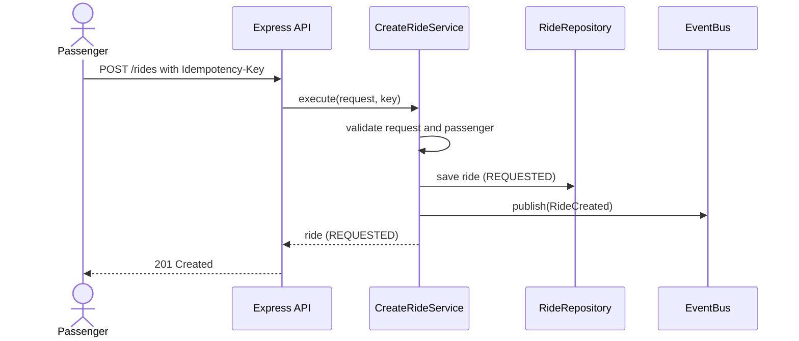
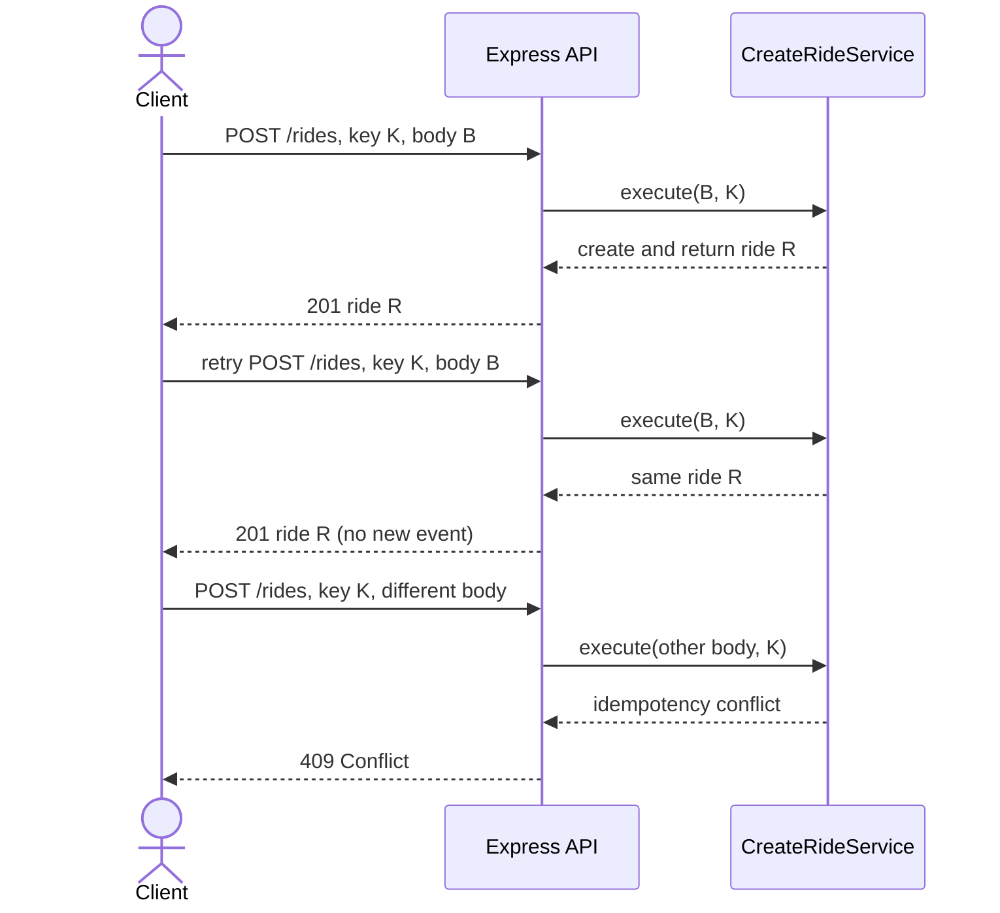
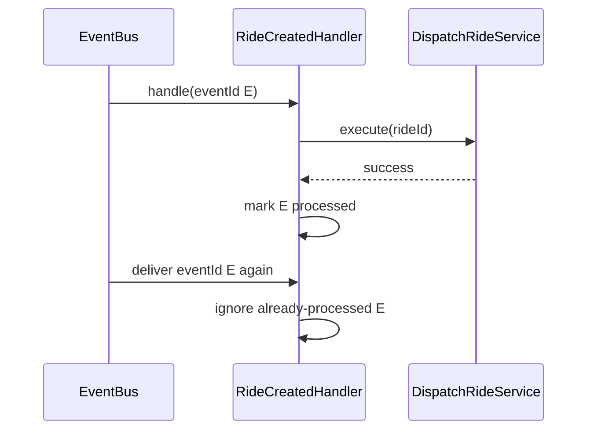
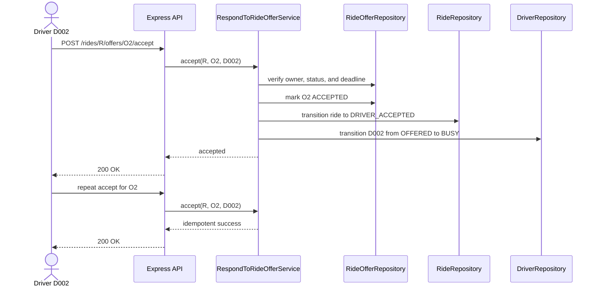
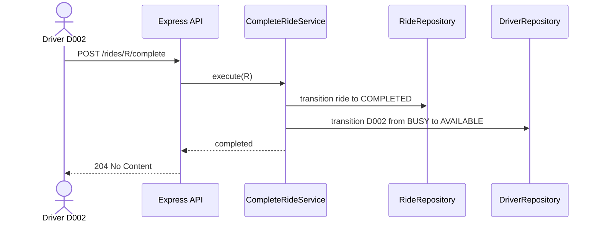

# Ride workflow sequence diagrams

Each diagram focuses on one part of the ride lifecycle so the participants and
state changes stay easy to follow.

## 1. Create a ride

The ride endpoint saves a `REQUESTED` ride and enqueues a `RideCreated` event.
It returns without waiting for matching.



## 2. Match a driver

A separate polling consumer handles the event and asks the matcher for the
nearest eligible driver. Previously offered drivers are excluded.

```mermaid
sequenceDiagram
    participant Bus as EventBus
    participant Consumer as Polling consumer
    participant Handler as RideCreatedHandler
    participant Dispatch as DispatchRideService
    participant Matcher as MatchDriverService
    participant Rides as RideRepository
    participant Offers as RideOfferRepository
    participant Drivers as DriverRepository

    Consumer->>Bus: consumeNext(handler)
    Bus->>Handler: handle(RideCreated)
    Handler->>Dispatch: execute(rideId)
    Dispatch->>Rides: transition REQUESTED to MATCHING
    Dispatch->>Offers: find previous offers
    Dispatch->>Matcher: match(pickup, excludedDriverIds)
    Matcher->>Drivers: find available drivers
    Note over Matcher: Filter by location and radius;<br/>sort by distance, then driverId
    Matcher-->>Dispatch: nearest candidate or none
```

If no candidate is available, the ride stays in `MATCHING` and can be retried.

## 3. Claim a driver and create an offer

The candidate must still be available when dispatch claims them. A lost claim
causes dispatch to try another candidate.

```mermaid
sequenceDiagram
    participant Dispatch as DispatchRideService
    participant CreateOffer as CreateRideOfferService
    participant Drivers as DriverRepository
    participant Rides as RideRepository
    participant Offers as RideOfferRepository

    Dispatch->>CreateOffer: execute(rideId, driverId)
    CreateOffer->>Drivers: claimForOffer(driverId)
    Drivers-->>CreateOffer: claimed; status becomes OFFERED
    CreateOffer->>Rides: assign driver; transition to DRIVER_ASSIGNED
    CreateOffer->>Offers: save PENDING offer
    CreateOffer-->>Dispatch: pending offer
```

The offer expires after its configured timeout; see [Offer expiry](#6-offer-expiry).

## 4. Handle duplicate requests and events

### 4.1 Duplicate HTTP request

The same key and payload return the original ride. Reusing the key with a
different payload is a conflict.



### 4.2 Duplicate event delivery

The handler records an event ID after successful dispatch. A later delivery
with that ID is ignored. Dispatch also returns an existing unexpired pending
offer if invoked again.



Idempotency and processed-event records are in memory and reset on process
restart.

## 5. Reject an offer and rematch

The rejected driver is released, but remains excluded from the ride's future
matching attempts.

```mermaid
sequenceDiagram
    actor Driver as Driver D001
    participant API as Express API
    participant Respond as RespondToRideOfferService
    participant Offers as RideOfferRepository
    participant Rides as RideRepository
    participant Drivers as DriverRepository
    participant Dispatch as DispatchRideService
    participant CreateOffer as CreateRideOfferService

    Driver->>API: POST /rides/R/offers/O1/reject
    API->>Respond: reject(R, O1, D001)
    Respond->>Offers: validate and mark O1 REJECTED
    Respond->>Rides: transition ride to MATCHING; clear assignment
    Respond->>Drivers: release D001 to AVAILABLE
    Respond->>Dispatch: execute(R)
    Dispatch->>Dispatch: exclude previously offered D001
    alt another driver is eligible
        Dispatch->>CreateOffer: create offer for D002
    else no driver is eligible
        Dispatch->>Dispatch: leave ride MATCHING
    end
    Respond-->>API: rejected offer
    API-->>Driver: 200 OK
```

## 6. Offer expiry

The timer is the normal expiry trigger. A late response also checks the
deadline, so it cannot accept an expired offer.

```mermaid
sequenceDiagram
    participant CreateOffer as CreateRideOfferService
    participant Timer as Expiry timer
    participant Expire as ExpireRideOfferService
    participant Offers as RideOfferRepository
    participant Rides as RideRepository
    participant Drivers as DriverRepository
    participant Dispatch as DispatchRideService
    participant API as Express API
    actor Driver

    CreateOffer->>Timer: schedule at expiresAt
    Timer->>Expire: execute(rideId, offerId)
    Expire->>Offers: mark offer EXPIRED
    Expire->>Rides: transition to MATCHING; clear assignment
    Expire->>Drivers: release driver to AVAILABLE
    Expire->>Dispatch: find next driver

    Driver->>API: late accept or reject
    API->>Expire: validate deadline
    Expire-->>API: expire offer; response is rejected
    API-->>Driver: error
```

Timers are process-local and do not survive restart. The deadline check on
subsequent requests or dispatch still catches an overdue offer.

## 7. Accept an offer

Only the assigned driver can accept a pending, unexpired offer. Repeating the
same successful acceptance returns success without applying the transition
again.



## 8. Complete a ride

Completion is allowed only after acceptance. The driver becomes available
again when the ride is completed.



Completing a ride that was never accepted is rejected. Repeating completion
after it succeeds is a no-op.

## 9. Two rides compete for one driver

Two dispatchers may select the same available driver from stale matching
results. The atomic claim decides which offer can proceed.

```mermaid
sequenceDiagram
    participant A as Dispatch for ride R1
    participant B as Dispatch for ride R2
    participant Drivers as DriverRepository

    Note over A,B: Both matched D001 while AVAILABLE
    A->>Drivers: claimForOffer(D001)
    Drivers-->>A: claimed; status becomes OFFERED
    B->>Drivers: claimForOffer(D001)
    Drivers-->>B: lost; driver is no longer AVAILABLE
    Note over A: Continue creating the offer for R1
    Note over B: Exclude D001 and try another candidate
```

Within one Node.js process, the check and status change happen in one
synchronous method. A database implementation should use a conditional update
and treat zero affected rows as a lost claim:

```sql
UPDATE drivers SET status = 'OFFERED'
WHERE id = ? AND status = 'AVAILABLE';
```

## Event retries and failures

The event bus retries handler failures up to three total attempts. After the
last failure, it moves the event to an in-memory dead-letter list and logs it.
Manual dispatch is available through `POST /rides/:rideId/dispatch`. Since the
ride save and event publication are not atomic, production deployments should
use an outbox or transactional messaging strategy.
