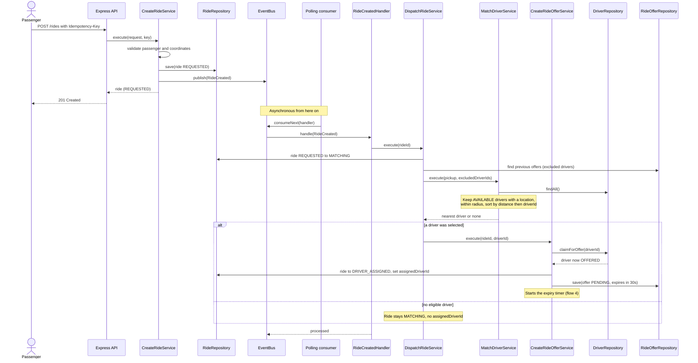
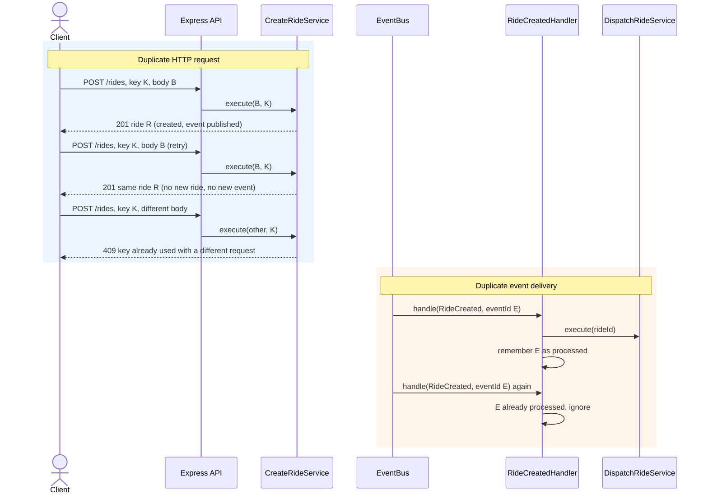
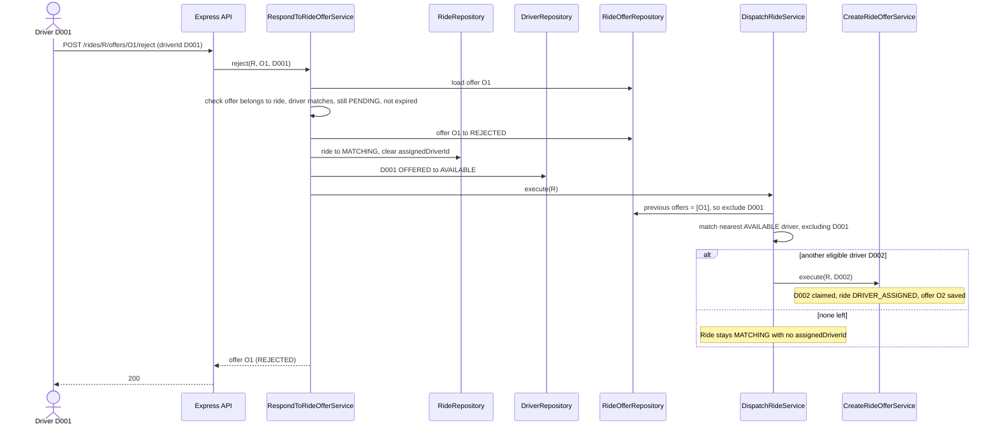
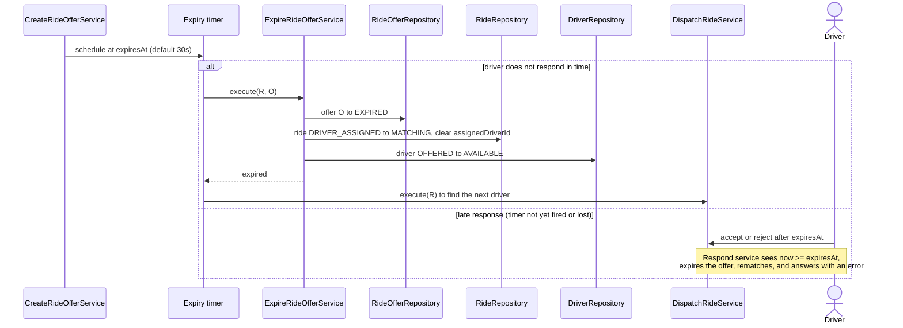
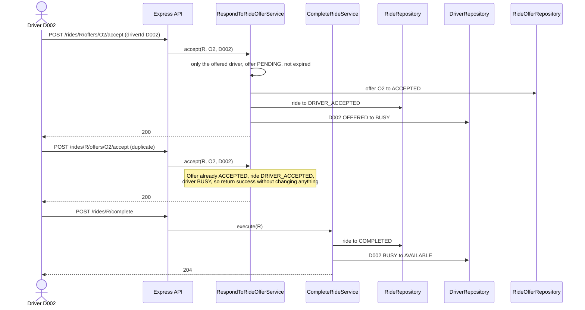
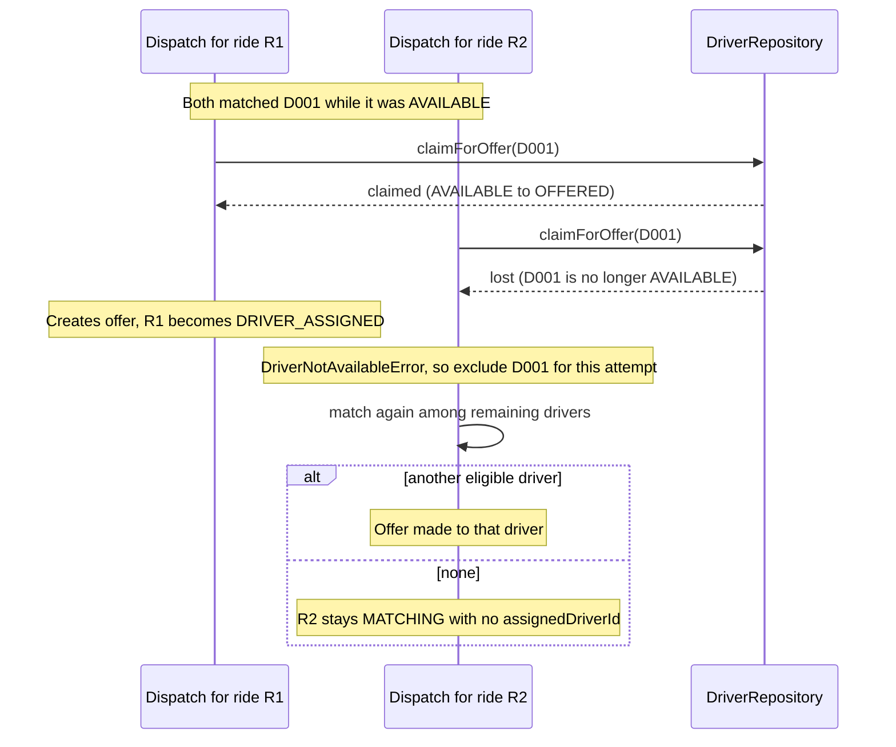

## 1. Create ride and asynchronous dispatch

The create endpoint does not wait for matching. Publishing only enqueues the
event; a separate polling consumer handles it. The API returns the ride in
`REQUESTED`, and the client sees the later state by reading the ride again.



**Why asynchronous.** Creation stays fast and independent of matching latency,
and dispatch can be retried without the caller re-sending anything. The cost is
eventual consistency.

**If processing fails.** The handler throws, the bus requeues the event, and
after three attempts it moves the event to an in-memory dead-letter list and
logs it. The ride remains `REQUESTED`, and `POST /rides/:rideId/dispatch`
retries it manually.

---

## 2. Duplicate requests and duplicate events

Idempotency is applied at the API edge and again at the event handler.



The handler records an event ID only after dispatch succeeds. If dispatch
throws, the event is not marked processed, so a retry runs it again. Dispatch
is also safe when repeated: if the ride already has a pending offer that has
not expired, it returns that offer instead of creating another.

Both stores (idempotency records and processed event IDs) are in memory, so
they reset when the process restarts.

---

## 3. Driver rejects and the ride is rematched




---

## 4. Offer times out

An expiry follows the same state transition as a rejection. There are two
independent triggers, so a missed timer never lets an expired offer be honored.



If a response arrives after the deadline, the offer is expired first and the
driver gets an error, never a late success. Timers are process-local and do not
survive a restart; the deadline check on the next request or dispatch still
catches an overdue offer.

---

## 5. Driver accepts, then the ride completes



An accept from any other driver, for another ride's offer, or for an offer that
is no longer `PENDING` is rejected (403 or 409). Completing a ride that was
never accepted is rejected with 409, and completing an already completed ride
is a no-op.

---

## 6. Two rides compete for one driver

This is the race from AC-09. Matching reads a snapshot of drivers, so two
dispatchers can both choose the same driver from stale data. The decision is
made at the write, using an atomic compare-and-set.



In a single Node.js process the check and the status change happen in one
synchronous method, so they cannot interleave. With a database the same step is
one conditional update, and zero affected rows means the claim was lost:

```sql
UPDATE drivers SET status = 'OFFERED'
WHERE id = ? AND status = 'AVAILABLE';
```

